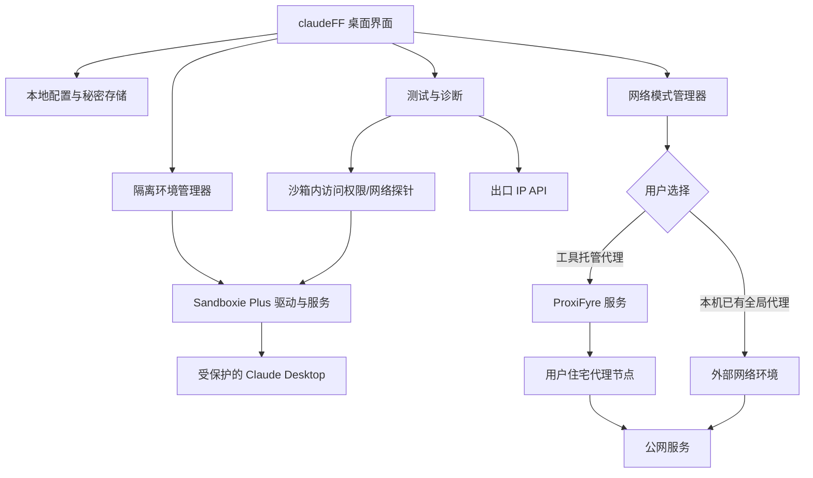
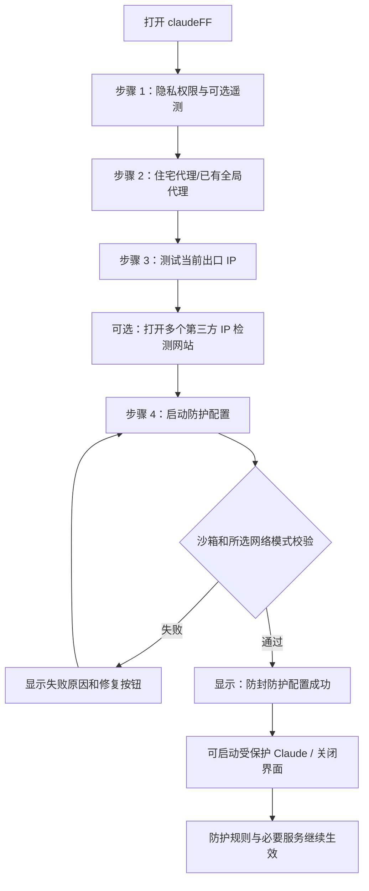

# claudeFF｜Windows 桌面隔离与网络隐私防护工具 — 技术方案 v1.0

> **文档用途**：供 GPT-6 Sol、Codex（编码代理）或人工开发者直接作为项目需求与技术实施依据。  
> **整理日期**：2026-10-12  
> **修订范围**：保留真实硬件；敏感访问限制与审计；可选遥测；正常功能优先。本文件是需求方案，尚未完成 Windows 实测。  
> **交付说明**：当前 0.1.0 的实际实现见 [实现与验证边界](实现与验证边界.md)，本文其余功能仍是需求目标，不能视为已交付。  
> **阶段**：最小可用原型（MVP，Minimum Viable Product）  
> **目标平台**：Windows 10/11，优先 64 位（x64）  
> **产品名称**：claudeFF｜Claude 桌面隐私防护工具（不构成防封效果保证）

---

## 0. 最重要的产品原则（务必遵守）

1. **直接在真实 Windows 宿主机运行**：优先轻量方案，不预设虚拟机，不自行重写沙箱内核。
2. **限制并审计敏感信息访问**：保留宿主机真实硬件信息，不生成、替换或随机化硬件指纹。通过现成沙箱限制浏览器资料、私人文件与相关注册表的访问，逐项验证范围。
3. **代理只负责网络转发**：允许填写住宅代理；允许使用用户已经配置的本地全局代理；可选提供“由本工具启用全局代理”。
4. **IP 纯净度与防护是否生效绝对解耦**：IP 信誉或第三方风险评分**不参与启动放行、失败判定、保护成功率计算**。低信誉、高风险、未知评分都只提示，由用户自行决定。
5. **可选 IP 检查功能**：显示当前实际出口 IP、国家/地区、网络运营商等信息；提供第三方检测网站入口，提醒交叉验证；无需付费 IP 信誉接口才能使用主功能。
6. **真实防护状态必须与界面一致**：没有完成沙箱接管，不能显示“防护配置成功”；普通 Claude 启动不能绕过沙箱后仍被宣称受保护。
7. **防封不作保证**：该工具只提供本地隐私及隔离措施，不提供规避实名认证（KYC，Know Your Customer）、账号验证、平台限制的承诺。
8. **正常使用优先**：新增限制必须经过正常功能回归，异常可单项回滚；未知目的连接不当作遥测盲目封锁。代理失效时明确提示联网与防泄漏的取舍，不静默切换直连。
9. **不做商业化杂项**：原型阶段**不做**注册、登录、激活卡密、支付、会员、后台管理、云端同步、远程服务器。

> **注意**：这些功能描述是软件工程目标；并不表示已经证实 Claude Desktop（Claude 桌面客户端）会读取表中每一种硬件数据，也不表示应用隔离能够消除服务端账号风控。

---

## 1. 产品定位和边界

### 1.1 要解决的问题

- 为 Claude Desktop 建立一个可重复使用的本地隔离环境；
- 尽量避免普通桌面程序无必要地读取宿主浏览器档案、私人文件及敏感注册表资料；
- 保留真实设备环境，不修改硬件身份、系统语言或时区；限制并审计敏感数据访问；
- 一键限制已确认可选的遥测，并管理官方隐私设置；正常联网和客户端功能是启用规则的前提；
- 根据用户选择，配置住宅代理出口或复用现有本机全局代理；
- 显示当前网络出口 IP 与连接状态，独立提供 IP 信誉检测链接；
- 一键配置、可视化查看生效项、随时停用并回滚。

### 1.2 不解决的问题

- 不保证账号不被 Claude / Anthropic 封禁；
- 不提供修改客户端二进制、绕过认证、破解订阅、绕过实名认证或规避平台服务器审查的功能；
- 不承诺获取、屏蔽或伪造所有系统级与内核级身份信息；
- 不承诺拦截或识别所有加密遥测字段；
- 不承诺更换代理能改变账号既有服务端记录；
- 不承诺普通浏览器的 WebRTC（网页实时通信）测试结果等于 Claude Desktop 自身的网络行为。

### 1.3 最小可用版本（MVP）交付物

- 1 个 Windows 桌面图形客户端；
- 1 个受管理的 Sandboxie Plus 沙箱环境；
- 1 套可持久保存的访问权限、审计和隐私设置档案；
- 1 个代理配置与连接检查模块；
- 1 个免费的公网 IP 查询模块；
- 1 个外部 IP 检测网站快捷入口区；
- 1 套安全启动 Claude 的流程；
- 1 套防护生效验证、日志、关闭与回滚机制。

---

## 2. 推荐技术栈与理由

| 分层 | 选择 | 职责 | 为什么选它 |
|---|---|---|---|
| 桌面图形界面 | C# + .NET 长期支持版 + WPF（Windows Presentation Foundation） | 配置界面、状态显示、通知、托盘 | 原生 Windows 集成直接，适合小型原型 |
| 应用沙箱 | Sandboxie Plus | 文件、注册表、进程隔离和访问限制 | 成熟、文档齐全、可命令行启动 |
| 进程级代理（首选） | ProxiFyre | TCP（传输控制协议）/ UDP（用户数据报协议）透明代理 | 避免从零编写网络内核组件 |
| 已有全局代理模式 | 只检测与复用用户现有网络环境 | 不自动修改系统代理或抢占第三方代理服务 | 降低兼容性与恢复风险 |
| 配置 | 本地 JSON（结构化配置）+ Windows DPAPI（数据保护接口） | 配置持久化、代理密码加密 | MVP 不需要数据库 |
| 沙箱执行验证 | 独立本地 Probe（探针）程序 | 验证文件/注册表访问限制、语言可见性和隔离状态 | 防止“配置存在但实际未生效” |
| 网络验证 | 系统网络接口 + 出站请求探针 + 日志 | 区分代理有效和发生直连 | 不依靠 IP 纯净度打分 |
| 打包安装 | 采用成熟的 Windows 安装方案 | 安装、依赖检查、卸载与恢复 | 避免一开始研发安装器 |

**技术选型结论**：`WPF + Sandboxie Plus + ProxiFyre + JSON/DPAPI`。不建议上来就使用 Hyper-V（微软虚拟化平台）、VirtualBox（虚拟机）、自研驱动或复杂浏览器指纹引擎。

> **关键许可提示**：Sandboxie Plus 由不同许可的组件构成，部分隐私增强功能需要支持者证书，商业使用可能需要商业证书；ProxiFyre 使用 AGPL-3.0（网络强著佐权许可证）。正式分发前必须核对二进制分发、修改、源代码披露和依赖许可证。MVP 优先作为独立管理器调用用户合法安装的原版工具，不直接改名重发第三方产品。

---

## 3. 整体架构



### 3.1 组件职责

**claudeFF 用户界面**：配置敏感资源访问权限、输入代理、运行检测、查看状态、开启/暂停保护、退出界面。

**SandboxManager（沙箱管理器）**：识别 Sandboxie 安装状态；创建命名沙箱 `claudeFF_Default`；保存/备份配置；重载沙箱规则；用受控入口启动应用；检查受保护进程；停用和恢复。

**NetworkManager（网络管理器）**：实现“工具托管代理”和“已有本机代理”两种互斥模式；检查代理是否在线；记录路由测试结果；对工具创建的代理服务进行启动、停止和回滚。用户选“已有本机代理”时，不能擅自替换或停止第三方网络软件。

**PrivacyPolicyManager（隐私策略管理器）**：管理敏感路径、用户授权例外和访问审计。每项记录期望策略、实际结果、验证路径、版本和时间。

**TelemetryManager（可选遥测与设置管理器）**：区分本地配置、账户级偏好和网络规则；读取当前值、保存变更前状态、应用后读回验证，支持撤销。未知设置不自动写入。

**NetworkProbe（网络探针）**：在目标进程相同的网络策略下查询公网出口与出站连通性，记录是否观察到直接连接。不能将管理界面自身一次代理请求，冒充为 Claude 进程已经通过代理。

---

## 4. 用户完整交互流程（按你要求）



### 4.1 首页设计

```text
┌──────────────────────────────────────────────────────────────┐
│ claudeFF  ·  Claude 隐私防护                      [设置] [×] │
├──────────────────────────────────────────────────────────────┤
│ ① 隐私权限与遥测   ② 代理网络   ③ IP 检测   ④ 启动防护   │
│                                                              │
│ [隐私保护]                                                    │
│ 隔离档案：默认配置       [新建] [选择] [恢复默认]              │
│ 本地文件/注册表保护  [开启]                                    │
│ 浏览器资料访问        [限制]       查看范围                 │
│ 私人文件访问          [限制]       授权文件                 │
│ 可选遥测              [检测设置]   一键限制                          │
│ 系统语言读取          [未支持全面阻止]                          │
│ 硬件设备信息          [保持真实，不改写]              │
│                                                              │
│                          [下一步：代理网络 →]                │
└──────────────────────────────────────────────────────────────┘
```

界面要展示“真实支持”而不是把无法实施的功能做成可点的假开关。系统语言读取限制如未通过验证，显示“未支持/部分限制”，不得返回伪造语言掩盖问题。

### 4.2 代理设置页

提供以下互斥选项：

**A. 由 claudeFF 配置代理（推荐用于验证）**

- 住宅代理类型：第一版优先支持 SOCKS5（套接字代理协议第 5 版）；
- 代理地址、端口、用户名、密码；
- 网络作用范围：
  - **仅 Claude 相关进程**（默认，干扰小）；
  - **系统全局代理**（可选，影响系统其他程序，必须明显提示和允许撤销）；
- “测试代理连接”按钮；
- 检测成功显示代理出口 IP，失败显示错误原因；
- 配置密码只存加密形式；
- 明示 HTTP/HTTPS（网页代理协议）并不自动具备 UDP 转发能力。若未来支持，则按协议能力做兼容性检测。

**B. 我已经使用本机全局代理，不需要 claudeFF 再设置**

- 不要求输入代理账号或密码；
- 不修改 Windows 系统代理设置；
- 不安装第二套网络转发服务；
- 可以读取并展示检测得到的当前出口 IP；
- 对现有代理的覆盖范围仅作检测，不能直接承诺“所有 Claude 子进程已受保护”；
- 如果无法验证进程级路由，提示“外部代理由用户负责，本工具未独立验证其全部网络流量”，**不因没有代理配置而否定本地沙箱保护**。

**C. 不填写代理，仍希望使用本地隔离（可选容错项）**

- 允许测试本地隔离；
- 显著提示“未启用本工具代理，也未声明现有代理；网络出口可能为本机原有出口”；
- 只能显示“本地隔离配置已生效”，不能显示“代理转发已验证”。

**关于“全局代理”**：一旦选中系统全局路由，必须先展示将影响的网络范围、现有网络软件冲突、管理员权限要求、异常情况下如何回滚。默认不采用它；首版先把“仅 Claude 进程”做好。

### 4.3 IP 查询页：完全不按纯净度判断防护

建议界面：

```text
[当前出口检测]
公网 IP：             xxx.xxx.xxx.xxx
IP 协议：            IPv4 / IPv6
归属国家或地区：       [仅供参考]
网络运营商/自治系统：  [仅供参考]
所选网络模式：         工具代理 / 本机已有代理 / 不使用代理
连接测试：             成功 / 失败 / 尚未检测

[重新测试出口 IP]  [打开第三方 IP 检测网页]

提示：推荐使用稳定且信誉较高的住宅 IP。第三方 IP 信誉、
“纯净度”和风控评分仅供参考，不影响继续操作。建议交叉验证。
```

#### 自动出口 IP 接口（免费方案）

| 功能 | 数据源 | 能返回什么 | 注意事项 |
|---|---|---|---|
| 公网 IPv4 | `https://api.ipify.org?format=json` | 公网 IPv4 | 免费，必要时添加备用供应商 |
| 公网 IPv4 / IPv6 | `https://api64.ipify.org?format=json` | 公网地址 | 结果取决于实际地址族与连接路径 |
| 国家、ASN（自治系统号） | IPinfo Lite（需免费令牌） | 基础地理、自治系统信息 | 免费服务不等于代理信誉/纯净度 API |
| 无须令牌的简化显示 | 仅显示 ipify 返回的 IP | 最小功能 | 无地区、运营商字段时显示“未知”，不能编造 |

实现要求：**请求必须使用用户选定的网络路径**。在“工具托管代理”模式，测试请求走同一代理配置；在“已有本机全局代理”模式，只报告本次请求实际所见的出口，并明确提示其结果未覆盖所有应用子进程。

#### 第三方检测网站按钮（各自独立）

- [Scamalytics：IP 风险与信誉参考](https://scamalytics.com/ip)
- [BrowserLeaks：DNS 泄露检测](https://browserleaks.com/dns)
- [BrowserLeaks：WebRTC 泄露检测](https://browserleaks.com/webrtc)
- [IPLeak：公网 IP 和网络检测](https://ipleak.net/)

**提示文案（固定展示）**：

> IP 纯净度与第三方风险评分仅供参考。不同网站数据源、检测维度和更新时间不同，建议通过多个站点交叉验证。即使检测结果较差，也可以继续启动 claudeFF；最终是否使用该代理由用户自行决定。第三方网站检测的是访问该网站的浏览器及网络路径，不一定等同于 Claude Desktop 的真实网络路径。

不要抓取第三方网页强行提取评分，也不要把没有官方接口的第三方页面当作可长期稳定调用的免费 API。

### 4.4 “启动防封配置”按钮的真实含义

点击后按顺序执行：

1. 检查 Sandboxie Plus 是否已安装、驱动与服务是否正常运行；
2. 备份必要配置，确认沙箱命名不冲突；
3. 创建/更新 `claudeFF_Default` 沙箱；
4. 应用已验证的敏感文件/注册表访问规则及可选遥测设置；
5. 为 Claude 的**实际可执行进程**配置强制入沙箱规则（如该安装形态可支持），不能只靠一个快捷方式；
6. 按用户选择启用代理、复用现有代理或仅启用本地隔离；
7. 加载配置并运行轻量探针（需要先确认当前进程没有使用旧配置）；
8. 检查沙箱、访问限制、隐私设置与网络状态，并通过正常功能回归；
9. 所选防护项验证通过后显示“防封防护配置成功”；部分项无法验证时显示“部分配置完成”，明确列出未通过项目。

**IP 纯净度分数、代理是否为“住宅”、IP 信誉高低，均不是成功条件。**

### 4.5 成功界面（用户要求的文案）

```text
┌──────────────────────────────────────────────────────────────┐
│ ✔ 防封防护配置成功                                         │
│                                                              │
│ 已确认：Sandboxie 运行正常、受保护启动规则已配置               │
│ 环境保护：已生效 X 项 / 未验证 Y 项                            │
│ 网络出口：当前用户选择的模式及出口检测结果                    │
│                                                              │
│ 现在可以运行 Claude 桌面客户端。                             │
│ 推荐点击 [受保护方式启动 Claude]。                            │
│                                                              │
│ [受保护方式启动 Claude]  [关闭窗口]  [关闭防护并恢复]           │
└──────────────────────────────────────────────────────────────┘
```

**必须区分“关闭窗口”和“关闭防护”**：

- **关闭窗口**：只关闭图形界面，必要的沙箱驱动规则与代理后台服务继续生效；如使用托盘模式，应明确保留状态。
- **关闭防护并恢复**：需要用户确认，停止由本工具管理的规则或服务、恢复本工具修改的配置；不能关闭与 claudeFF 无关的其他代理服务。
- **从普通 Claude 桌面快捷方式打开是否仍受保护**：只有 `ForceProcess` 等强制沙箱规则已实际生效，且对 Claude 的安装方式测试通过，才能提示普通快捷方式也受保护。否则必须要求用户使用 **“受保护方式启动 Claude”** 快捷方式，避免脱离沙箱。

### 4.6 固定免责声明（首次启动、成功页均可查看）

> **免责声明 / 风险告知**  
> Claude 的账号风控与封禁机制复杂，可能涉及付款信息、网络 IP、设备与系统信息、账号历史、对话或使用行为、身份验证等多种因素；具体机制并未完全公开，不能确定上述每一种信息是否用于某一次封禁判断。  
>  
> claudeFF 仅提供本地程序隔离、敏感信息访问限制与审计和网络代理配置工具，目标是尽可能减少不必要的宿主机信息暴露。软件无法保证避免账号被限制或封禁，也不能解决实名认证（KYC，Know Your Customer）、付款风控或其他平台账号验证问题。  
>  
> IP 纯净度检测结果只作提示，低信誉 IP 也不会阻止使用；住宅 IP、本地隔离或任何一项检测通过都不代表账号安全。用户应遵守服务提供方的适用条款，自行决定是否使用相关网络服务。

---

## 5. 敏感信息访问限制与审计（本次修订的核心）

### 5.1 范围和真实能力

保留宿主机的真实硬件身份，不生成假 MAC、磁盘序列号、固件、语言或位置。硬件信息可能仍对应用可见，不宣称匿名设备或消除设备关联。本文件不表示已经证实 Claude 会读取这些敏感资源，也不把读取行为与账号封禁建立未经证实的因果关系。

| 对象 | 策略 | 验证与边界 |
|---|---|---|
| 本机浏览器档案 | 限制读取配置、扩展资料、Cookies、历史、保存的登录信息与语言偏好文件 | 覆盖实际识别出的浏览器、多档案和自定义路径；不遍历或采集密码内容 |
| 私人文件 | 限制未授权的个人目录，允许用户明确选择的文件或目录 | 保证附件上传下载；默认不授权整个用户目录 |
| 浏览器/用户相关注册表 | 对确认的敏感项设访问限制 | 不整体封锁应用运行依赖的系统注册表 |
| 浏览器语言 | 阻止读取宿主浏览器偏好文件 | 不等同于阻止 Claude 自身内嵌网页读取运行时语言 |
| 系统语言 | 研究并记录可限制的读取路径 | Windows 有直接语言查询 API；封锁文件或注册表不足以全面隐藏，不伪造返回值；首版不承诺全面阻止 |
| 原始公网出口 | 通过代理转发与直连限制，减少对目标服务暴露原始出口 | 仅对验证过的路径作结论；服务仍能看见代理出口 |
| 局域网地址/网卡信息 | 单独审计 | 代理不自动隐藏本地网卡地址；不承诺全面不可读取 |

Sandboxie 的写入隔离不能直接作为敏感文件不可读的证据。研究 `ClosedFilePath`、`ClosedKeyPath` 和经授权的隐私模式，并验证继承模板与例外规则没有重新开放受限资源。规则作用于实际受保护的进程树；外部系统服务、浏览器登录流程、连接器和本地工具的访问边界单独记录。

首版采用兼容优先策略，保留运行时、应用自身配置和必要系统资源。用户主动选择的附件可通过受控复制或最小范围授权进入沙箱；具体方式先验证兼容性。关闭授权不会删除已上传到服务端的数据。

### 5.2 一键限制可选遥测与隐私设置

界面按钮：**一键限制可选遥测**。点击后逐项检测、保存旧值、修改、读回验证，并展示“已关闭 / 原已关闭 / 需手动处理 / 不支持 / 未验证 / 已回滚”。不提供虚假的“全部遥测已关闭”状态。

- **官方模型改进偏好**：官方提供 Settings > Privacy > Help Improve our AI models；属于账户级训练偏好，不等同于关闭运行遥测。只通过确认支持的接口或当前登录会话中经过验证的界面自动化修改。无法可靠操作时提供设置入口，不伪造本地配置键。
- **可选位置使用**：官方隐私面板有用于产品功能的位置使用偏好；关闭后可能影响本地化搜索结果，应用前展示这一具体影响。它不关闭平台安全所需的 IP/区域处理。
- **可选使用统计/崩溃上报**：仅当前桌面版本确有开关或正式支持的配置时自动关闭。尚未确认统一的桌面遥测总开关，不假定存在。Claude Code 的环境变量不能直接当作 Claude Desktop 的开关。
- **本地文件、浏览器、扩展及工具权限**：属于访问授权，单独显示。保留用户正在使用的正常功能；未确认影响的权限变更不放入默认批量操作。
- **网络遥测限制**：只拦截已确认独立、可选且回归测试通过的遥测目的地。无法区分业务与遥测、共用域名或无法判断的连接仅作连接审计；不封锁整个服务域名，不默认解密 HTTPS 或安装中间人证书。

账户设置可能跨设备生效，操作前在变更摘要中说明。退出登录、权限不足、版本不匹配时保留待处理状态。恢复时只撤销本工具修改过且当前值仍与本工具写入值一致的设置，不覆盖用户之后的更改。未知原值不得自动猜测恢复。

### 5.3 正常使用优先与回滚

**正常联网和常用功能是规则上线的必要条件。** 默认不启用未经验证的广泛语言/API 拦截、共享域名封禁或全盘文件封锁。首次先记录无新增限制时的正常基线；再逐项应用规则，失败时回退本次规则，保留已通过的规则，并报告差异。

兼容验收至少覆盖：启动、登录和浏览器授权回调、会话保留、发消息、流式回复、历史记录、附件上传下载、用户所用的搜索/连接器/本地工具、客户端更新以及重启。需要账号交互的测试由用户在 Windows 中完成；不得仅凭探针联网成功宣称客户端功能正常。未测试功能标注未验证，不承诺所有版本永久兼容。

提供“撤销本次限制”和“恢复本工具修改的设置”。不通过自动取消全部隐私规则掩盖故障。若用户明确要求某项限制但无法兼顾功能，保留为待处理或不支持并说明冲突，不能静默放行后显示保护成功。

**代理失效是单独的取舍**：不暴露原始出口与代理断开后继续直连不能同时成立。防泄漏模式在代理故障时暂停目标进程联网，提示修复代理或明确选择停用该保护并恢复直连；不会静默直连。不使用代理仍可启用本地文件保护，但不得显示原始出口已隐藏。

### 5.4 访问审计与探针

记录时间、进程、资源类别、脱敏路径或目的地主机、允许/拒绝、命中规则及检测来源。记录实际访问与实际拒绝；仅写入配置不能算拦截证据。不记录密码、Cookies 内容、令牌、完整对话或私人文件内容。

用专用无敏感内容的测试文件验证允许与拒绝，不读取用户真实浏览器秘密。分别测试宿主与沙箱视角、正常子进程、权限撤销和重启后的规则。语言检查报告具体查询接口，不能将一个接口受限推断为所有接口受限。加密连接日志只能证明目的地等元信息，不能证明传输了何种敏感内容；审计也不能保证捕获全部访问。

---

## 6. 网络层的正确架构

### 6.1 三种网络状态，不混淆

| 模式 | 是否由本工具配置代理 | 是否允许继续 | 成功状态描述 |
|---|---|---|---|
| 工具托管代理 | 是 | 连接验证通过即可按该模式启用 | “所选代理连接已验证” |
| 用户已有本机全局代理 | 否 | 是 | “外部网络配置，已检测本次出口” |
| 未配置代理 | 否 | 是 | “未提供代理保护，仅本地隔离” |

**任何模式均不运行 IP 纯净度强制校验。** 若代理不可连通，要报告“代理连接失败”，这与“IP 纯净度低”是不同错误。

### 6.2 TCP、UDP、IPv4、IPv6、DNS、WebRTC

- **TCP**：确认受管进程的 TCP 出站连接按指定网络策略路由。
- **UDP**：单独验证所选代理是否真正支持 UDP；不能因为 SOCKS5 端口可连接就认定 UDP 已被保护。
- **IPv4/IPv6**：分别探测。若某一地址族不能确保按既定策略处理，应提示、限制该路径或标为未验证，不允许静默直连。
- **DNS**：远端代理代解析时可减少本地普通 DNS 查询；但应用可能使用独立解析实现，如 DoH（基于 HTTPS 的 DNS），不能只靠传统 UDP 53 规则。
- **WebRTC**：这属于可能使用 UDP 或浏览器网络组件的特定行为；对 Claude Desktop 是否实际使用须测试。普通浏览器的 WebRTC 检测不能证明客户端自身的 WebRTC 行为。
- **代理断线**：工具托管代理模式应优先保证**失败时阻断出站**（Fail Closed），而不是静默回到宿主网络直连；需要先在目标 Windows 环境里验证拦截机制与系统兼容性。

### 6.3 与第三方全局代理共存

- 检测用户已启用系统代理或网络隧道，仅作为状态参考；
- 用户选择“已有全局代理”后，**不**自动安装、启停、修改 ProxiFyre 或其他代理引擎；
- 不修改用户原有的 Windows 代理、DNS、路由表设置；
- 不读取第三方代理软件的账号密码；
- 本工具的公网 IP 查询只说明**测试请求**的出口，不证明所有应用流量一致；
- 若发现沙箱进程存在未经验证的直连能力，展示风险提示，不伪装成全部受控。

### 6.4 工具托管代理与“全局开关”

- 第一优先实现：**仅 Claude 进程及已确认的相关子进程**。
- “工具启用系统全局代理”作为可选高级开关，可复用 ProxiFyre 的全局匹配规则；必须在管理权限、路由冲突、驱动可用性、恢复路径验证后开放。
- 全局模式需要明确提示“其他应用联网可能受影响”；不允许在无提示情况下改动整个系统网络。
- 为防止目标进程重启或代理服务异常，需检查守护服务状态。单纯设置环境变量并不等同于透明接管。

### 6.5 为什么建议使用 ProxiFyre

该项目已经提供：按应用匹配、TCP/UDP 转发、IPv4/IPv6 支持、Windows 服务运行和管理界面。原型可先通过它的公开配置与服务接口实现集成。

**已知限制**：仓库说明特殊的 IPv6 分片 UDP 流量可能直通；SOCKS5 凭证在原生示例配置中可能明文保存。因此项目需明确标注不能保证零泄露，并为凭证保护和敏感日志清理做额外设计。**不得复制代码后忽略 AGPL-3.0 许可证。**

---

## 7. Claude Desktop 的受保护启动：必须先做兼容验证

### 7.1 启动流程

开发优先使用 Sandboxie 官方提供的 `Start.exe` 参数接口。官方示例形式：

```powershell
# 示意：路径、可执行文件实际位置必须通过安装检测获得
& 'C:\Program Files\Sandboxie-Plus\Start.exe' /box:claudeFF_Default 'C:\Path\To\VerifiedApp.exe'
```

**特别注意**：不能假定现代 Claude Desktop 一定有传统固定位置的 `Claude.exe`。它的 Windows 安装方式、MSIX（Windows 应用包）权限和子进程结构可能影响能否被 Sandboxie 接管。需要先用实际安装版本完成兼容性验证。

### 7.2 防止普通快捷方式绕过

官方 Sandboxie 支持 `ForceProcess`（强制程序进入沙箱），但其作用受实际可执行文件、安装路径、进程创建方式及沙箱规则影响。

应按以下顺序处理：

1. 识别 Claude Desktop 实际程序入口；
2. 验证能否通过 `Start.exe` 正确进入指定沙箱；
3. 配置并测试强制程序入沙箱规则；
4. 用正常 Windows 桌面快捷方式启动一次，实测该进程是否被接管；
5. 若验证失败，只允许显示“请通过 claudeFF 受保护快捷方式启动”，不可暗示普通双击也有效；
6. UI 退出后重新验证强制入沙箱规则仍有效。

### 7.3 兼容性风险

- MSIX/UWP 类应用包或特殊启动器可能不适配常规 `Start.exe` 路径；
- Claude 的更新流程可能更换进程入口或安装路径；
- 辅助进程、系统服务、嵌入式浏览器组件不一定全部位于同一沙箱；
- Claude 内部某些需要特殊系统权限或虚拟化能力的功能可能不可用；
- 如果兼容性不满足，版本 1 应报告“不支持该安装方式”，**不应为了显示成功而允许裸启动**。

---

## 8. 状态机、成功判定与异常处理

### 8.0 一体化验证与范围（用户最新要求，优先于旧验收表述）

主工具与验证入口集成在同一窗口：先开启防护，再点击“验证防护”。独立探针由工具后台调用，用户无需另开验证程序。

验证清单仅覆盖本工具实际提供、且本次已启用的防护/审计功能。没有提供、没有开启、尚未应用的功能不列入清单，不影响结论；不能为了显得全面堆叠“不支持”项。已有全局代理的一次出口查询属于信息展示，不冒充本工具提供的网络保护。

Claude 的登录、聊天、附件等功能由用户在 Windows 安装客户端后实际体验；这是独立的兼容性验收，不混进“防护验证通过”的评分或必需项。无 Windows 环境时可以先交付可运行程序与验证逻辑，但不得伪称已经完成 Windows 实测。


### 8.1 运行状态

| 状态代码 | 中文状态 | 行为 |
|---|---|---|
| `NOT_CONFIGURED` | 未配置 | 允许编辑；禁止显示已成功 |
| `CONFIGURING` | 正在应用配置 | 禁止重复点击，显示实际步骤 |
| `ACTIVE_VERIFIED` | 防封防护配置成功 | 所选已实现且已启用的防护项实测通过，明确列出范围；Claude 使用另行验收 |
| `ACTIVE_PARTIAL` | 部分配置完成 | 保留能正常工作的功能，列出缺项 |
| `PROXY_FAILED` | 所选代理连接失败 | 不评价 IP 纯净度；允许修改代理 |
| `SANDBOX_FAILED` | 沙箱初始化失败 | 不允许假成功 |
| `STOPPING` | 正在关闭保护 | 执行回滚、验证 |
| `STOPPED` | 防护已关闭 | 服务与规则恢复到受管理范围内的原状态 |

### 8.2 判定矩阵

| 检查内容 | 工具托管代理 | 已有全局代理 | 不使用代理 |
|---|---|---|---|
| 沙箱正常、规则应用成功 | 必需 | 必需 | 必需 |
| 目标启动入口/受保护快捷方式可用 | 必需 | 必需 | 必需 |
| Claude 正常使用回归 | 用户单独验收，不计入防护验证 | 用户单独验收，不计入防护验证 | 用户单独验收，不计入防护验证 |
| 敏感资源访问规则真实验证 | 按用户启用项判定 | 按用户启用项判定 | 按用户启用项判定 |
| 代理连接成功 | 必需 | 不属于本工具可强制校验项目 | 不适用 |
| IP 纯净度/第三方评分 | **不检查、不阻止** | **不检查、不阻止** | **不检查、不阻止** |
| 检测出口 IP | 提供，但不参与纯净度判断 | 提供，但不代表进程级完整保护 | 可选 |
| 无法确认客户端进程全部网络出口 | 显示“部分验证” | 显示“外部代理未独立验证” | 标注无代理 |

**可见文案建议**：

- 仅所选已提供且已启用防护项目实测通过时显示“防封防护配置成功”，下方写明已验证范围；部分通过显示“部分配置完成”，不得承诺不会封禁；
- 如果选择现有本机全局代理，写“网络出口由本机已有代理管理，不属于本工具承诺的强制代理隔离范围”；
- 没有任何评分阈值或“高风险 IP 禁止使用”的逻辑。

### 8.3 异常处理

- Sandboxie 未安装：展示官网安装入口与必要依赖；
- 缺乏管理员权限：提示哪一步需要提权，不反复无限弹窗；
- 用户代理地址错误：区分 DNS 解析失败、认证失败、连接拒绝、超时；
- 代理无 UDP 支持：明确提示，不悄悄降级成 UDP 直连；
- 应用更新后入口失效：阻止展示已验证状态，提醒重新检查；
- IP 查询 API 不可用：展示“查询失败”，允许继续配置，不误判沙箱失败；
- 用户 IP 风险评分很差：仅提醒，不影响“启动防护配置”按钮；
- 程序异常退出：保存受管理规则快照以便修复，下次启动提示恢复；
- 卸载：提示是否撤销专属规则、服务和沙箱数据；删除沙箱数据前明确可能丢失登录缓存。

---

## 9. 数据结构建议

原型期使用 **JSON（结构化文本格式）** 即可，不引入 SQLite（轻量数据库），以免增加依赖。

```json
{
  "schemaVersion": 1,
  "profileId": "claudeFF_Default",
  "displayName": "默认隔离配置",
  "privacy": {
    "hardwareIdentityPolicy": "host_unchanged",
    "restrictBrowserProfiles": true,
    "restrictPrivateFiles": true,
    "allowedPaths": [],
    "systemLanguageReadRestriction": "unverified",
    "optionalTelemetryPolicy": "verified_optional_only",
    "preserveNormalFunctionality": true
  },
  "network": {
    "mode": "managed_proxy",
    "scope": "claude_processes",
    "proxyProtocol": "socks5",
    "host": "proxy.example.invalid",
    "port": 1080,
    "credentialReference": "dpapi:local-credential-id",
    "ipReputationCheckRequired": false
  },
  "safety": {
    "useVerifiedProtectedLauncher": true,
    "blockDirectFallbackWhereSupported": true,
    "requireUserAcknowledgement": true
  }
}
```

说明：

- 这份 JSON **仅是 claudeFF 自身配置结构的草案**，不是 Sandboxie 或 ProxiFyre 可以直接读取的配置；
- 用户名和密码不能写入此文件明文；
- `systemLanguageReadRestriction=unverified` 表示尚未证实可全面阻止语言读取；配置期望与实际验证结果分开存储；
- `ipReputationCheckRequired=false` 明确体现“IP 纯净度绝不作为启动门槛”；
- 参数 `host` 使用保留示例域名，不能视为有效代理服务器。

---

## 10. 代码模块与建议目录

```text
claudeFF/
├── README.md                        # 中文使用与开发说明
├── docs/
│   ├── architecture.md              # 技术架构
│   ├── compatibility-matrix.md       # Windows / Claude / Sandboxie 版本兼容矩阵
│   ├── testing.md                   # 手动和自动测试规范
│   └── third-party-licenses.md      # 第三方许可证说明
├── src/
│   ├── ClaudeFF.App/                 # WPF 界面
│   ├── ClaudeFF.Core/                # 配置模型、状态机与验证逻辑
│   ├── ClaudeFF.Sandbox/             # Sandboxie 集成
│   ├── ClaudeFF.Network/             # 代理集成与网络探测
│   ├── ClaudeFF.Probe/               # 沙箱内只读环境探针
│   ├── ClaudeFF.Security/            # DPAPI 与敏感信息脱敏
│   └── ClaudeFF.Installer/           # 依赖检查、安装/卸载
└── tests/
    ├── ClaudeFF.UnitTests/          # 单元测试
    └── ClaudeFF.IntegrationTests/   # Windows 集成测试
```

### 10.1 UI 最少页面

1. 欢迎页：依赖检测、免责声明；
2. 隐私权限与遥测页：受限资源、授权例外、一键限制可选遥测和逐项结果；
3. 住宅代理页：用户代理/本机代理/无代理；
4. IP 检测页：出口 IP 与第三方网页入口；
5. 启动与结果页：进度、成功/失败、受保护启动、关闭与回滚。

保持界面极简，不使用复杂的后台管理控制台风格。不搞多账户管理、不做用户充值，不搞云端控制台。

### 10.2 进程与权限边界

- WPF 界面尽量普通用户权限运行；需要驱动、服务或系统网络改动时明确请求管理员权限；
- 不把任意用户输入拼接到高权限 Shell（命令解释器）脚本；
- 使用参数化进程启动和严格路径检查；
- 代理凭证采用 Windows DPAPI，加密存储，界面与日志默认遮蔽；
- 本地日志仅记录诊断必要信息，不记录登录令牌、完整对话内容或明文代理密码；
- 不向自建云端上传设备扫描结果或用户的真实公网 IP；
- 备份任何将要修改的配置，保证撤销与回滚。

---

## 11. 开发里程碑（严格顺序，不要并行造轮子）

### 阶段 0：交付一体化工具与验证能力，再由用户进行 Windows 使用验收

**最新开发安排**：先在 Linux 编写并交叉编译 Windows 工具，将实际访问验证集成到工具中。用户在 Windows 安装依赖、开启防护并运行验证后，再安装 Claude 测试正常使用。下列兼容测试仍必须进行，但不作为编写工具前的阻塞条件。

- 安装官方 Sandboxie Plus，记录版本与许可证状态；
- 手工创建测试沙箱；
- 验证 Claude Desktop 能否从沙箱启动、登录、保持缓存；
- 验证 Sandboxie 强制程序规则是否能接管正常双击；
- 验证常用 Claude 功能、辅助进程和更新场景；
- 未经用户 Windows 使用测试，不宣布客户端兼容性验收完成。

**交付**：兼容性报告与功能限制清单。

### 阶段 1：图形界面 + 沙箱管理

- 完成 WPF 主窗口及配置向导；
- 实现 Sandboxie 安装检测、专属沙箱创建、启动与停止；
- 实现浏览器资料/私人文件/注册表访问限制、授权例外、独立探针和访问审计；
- 实现可验证的官方隐私设置管理与可选遥测限制，不支持的设置给出手动入口；
- 实现受保护快捷方式、普通快捷方式强制接管验证；
- 实现关闭窗口不停止规则、真正停用可恢复。

**交付**：不依赖住宅代理也能启动的本地隔离 MVP。

### 阶段 2：网络代理与出口查询

- 支持 SOCKS5，优先完成仅 Claude 进程代理；
- 加入“已使用本机全局代理”选项；
- 加入可选的由工具启用全局代理；
- 实现代理连通、出口 IP、DNS/UDP/IPv6 基础诊断；
- 增加 ipify 出口查询及 IPinfo Lite 可选扩展；
- 外部 IP 风险网页按钮和固定提示文案；
- 确保 IP 信誉分数从不参与防护成功判定。

**交付**：可选代理路由的网络隐私原型。

### 阶段 3：打磨、验收与安装包

- 完成失败状态、诊断、恢复和卸载；
- 验证系统重启、客户端更新、代理断线；
- 复核第三方许可、分发方式和安装依赖；
- 完成打包及文档。

**交付**：可重复安装与测试的 Windows 原型。

---

## 12. 验收测试清单（必须实际跑，不许只看配置）

| 编号 | 测试用例 | 通过条件 |
|---|---|---|
| T01 | 首次启动未安装 Sandboxie | 显示依赖缺失，不假成功 |
| T02 | 沙箱正常安装 | 能创建专属环境并成功运行探针 |
| T03 | 浏览器资料访问 | 对识别到的档案路径拒绝读取；报告浏览器及路径覆盖范围 |
| T04 | 私人文件与授权例外 | 未授权文件不可读；用户选择的附件可上传；撤销后再次拒绝访问 |
| T05 | 系统语言读取边界 | 分别报告文件/注册表/API 查询结果；未全面阻止时不显示已隐藏 |
| T06 | 保留真实设备环境 | 无 MAC、卷序列号、固件、语言、时区替代配置 |
| T07 | 受保护方式启动 Claude | 进程确实属于指定沙箱 |
| T08 | 双击原始 Claude 快捷方式 | 如果启用强制沙箱规则，必须实际被接管；否则给明确警告 |
| T09 | 输入错误代理密码 | 显示认证失败，不误判为 IP 不纯净 |
| T10 | 有效 SOCKS5 代理 | 受测连接经指定网络路径，出口 IP 正确显示 |
| T11 | 代理断开 | 不发生无提示直连；无法阻断时明确报告缺陷 |
| T12 | IPv6/UDP 测试 | 逐项记录通过、失败或未验证，不能用一个 TCP 成功代替 |
| T13 | 用户已有本机全局代理 | 不安装第二套代理，不修改用户网络配置 |
| T14 | IP 查询 API 故障 | 不阻止沙箱配置，显示查询失败 |
| T15 | 第三方网站显示高风险 IP | 仍允许继续操作，仅显示建议提示 |
| T16 | 多个 IP 检测网站交叉验证 | 正常打开，提示浏览器与 Claude 网络路径可能不同 |
| T17 | 关闭图形界面 | 既有被管理的保护规则/服务仍持续运行 |
| T18 | 点击“关闭防护并恢复” | 仅撤销本工具的修改，恢复原有配置 |
| T19 | 代理密码与调试日志 | 不出现明文凭证或不必要的个人数据 |
| T20 | Claude 版本更新 | 自动检测原有保护规则是否仍覆盖新入口 |
| T21 | 许可证与依赖检查 | 未授权的支持者功能不会被伪装为已开启 |
| T22 | 防护成功页 | 显示确切已生效项、未验证项与免责声明 |
| T23 | 正常功能回归 | 第 5.3 节常用路径通过，未测试的能力单独标注 |
| T24 | 一键限制可选遥测 | 仅修改确认存在的可选项；逐项读回，不输出全部遥测已关闭 |
| T25 | 新规则造成故障 | 撤销本次规则后复测；不静默关闭其他已生效保护 |
| T26 | 账户偏好不可自动操作 | 提供官方设置入口，显示待手动处理，不写伪造配置 |
| T27 | 审计日志 | 测试访问与日志可对应，无秘密内容；连接元信息不冒充内容审计 |
| T28 | 恢复设置 | 只恢复本工具变更，不覆盖用户之后的设置修改 |

**禁止使用“IP纯净度 = 防护有效”之类的测试用例和成功条件。**

---

## 13. 风险分级与成本控制

| 技术点 | 复杂度 | 对 MVP 的策略 |
|---|---|---|
| WPF 图形向导 | 低 | 直接实现 |
| 沙箱创建/启动/回滚 | 中 | 调用 Sandboxie 的官方机制 |
| 浏览器与私人文件权限 | 中 | 最小授权、逐项验证、兼容性回归 |
| 系统语言全面阻止读取 | 高 | 研究项；不伪造、不影响正常功能 |
| 可选遥测与隐私设置 | 中高 | 逐版本确认，读回验证，无法区分则只审计 |
| 自研完整“虚拟硬件指纹” | 极高 | 不做 |
| 单进程独立时区全面仿真 | 高 | 首版不做假开关 |
| SOCKS5 进程级转发 | 中 | 复用 ProxiFyre |
| 可靠的强制断线阻断 | 中高 | 必须测试后才能承诺 |
| 可选全局透明代理 | 中高 | 基础功能稳定后再开放 |
| 真实数据内容级遥测审计 | 高且有加密限制 | 不作为 MVP 的必要条件 |
| IP 纯净度商业数据库 | 非必需 | 不集成；仅开放第三方网站 |

**成本与风险最小路径**：先跑通 Sandboxie 对当前 Claude Desktop 版本的真实兼容性，再封装自己的界面；仅在此成立后投入代理集成。这样可避免做完客户端后才发现底层沙箱无法稳定支持目标程序。

---

## 14. 给 GPT-6 Sol / Codex 的执行提示词（可直接复制）

> 你是资深 Windows 桌面与系统集成工程师。请以当前文档作为唯一的产品需求基线，开发 claudeFF 的 MVP（最小可用原型）。实现 C# / .NET / WPF 图形客户端和后台独立探针，在同一工具中提供“开启防护”和“验证防护”；用户随后在 Windows 实测 Claude 的正常功能。验证清单只包含实际提供且已启用的防护。项目优先复用成熟沙箱及代理组件，禁止从零编写内核沙箱驱动或自行伪造“全部硬件指纹已隐藏”的结论。
>
> 需求优先级：
> 1. 程序安装检查、沙箱管理、受保护启动、强制入沙箱验证；
> 2. 可验证的浏览器资料/私人文件/注册表访问限制、访问审计与授权例外；
> 3. 一键限制可选遥测、管理官方隐私设置；正常功能优先，禁止伪造硬件、语言或位置；
> 4. 住宅 SOCKS5 代理配置、已有全局代理模式、可选系统全局代理模式、实际出口 IP 检查；
> 5. Scamalytics、BrowserLeaks、IPLeak 外部检测网站入口；
> 6. 防护状态机、关闭窗口与关闭防护的区别、日志、异常处理与回滚；
> 7. 固定风险免责声明。
>
> **核心产品约束：IP 信誉/纯净度评分只能显示提示，绝不作为代理连接测试、沙箱生效测试或“防护成功”判定门槛。** 即使使用者选择风险评分较差的代理，也不得禁止其继续。
>
> 用户填写的代理只用于网络转发，不实现代理售卖和商业化账号系统。优先做到原型真实可运行、行为可测试、异常可回滚，不要堆积无用功能。凡是不能真实验证的功能，必须标成“未验证/未支持”，不要用假开关和假成功提示。每阶段提交代码、测试结果、已知限制和下一步清单。禁止擅自关闭系统防火墙或修改其他代理软件的设置。

---

## 15. 官方参考资料与开源仓库

> 以下为截至 2026-10-12 检索到的技术资料。开发时应锁定具体版本，再核对最新版项目文档及许可证。相关 GitHub 项目不属于 claudeFF 原作者。

### 基础与沙箱

1. [Sandboxie Plus 开源仓库](https://github.com/sandboxie-plus/Sandboxie)
2. [Sandboxie 官方命令行启动文档](https://sandboxie-plus.github.io/sandboxie-docs/Content/StartCommandLine/)
3. [Sandboxie 强制程序规则](https://sandboxie-plus.github.io/sandboxie-docs/Content/ForceProcess/)
4. [Sandboxie 文件访问限制](https://sandboxie-plus.github.io/sandboxie-docs/Content/ClosedFilePath/)
5. [Sandboxie 注册表访问限制](https://sandboxie-plus.github.io/sandboxie-docs/Content/ClosedKeyPath/)
6. [Windows 用户语言查询 API](https://learn.microsoft.com/windows/win32/api/winnls/nf-winnls-getuserdefaultuilanguage)
7. [Sandboxie 访问追踪](https://sandboxie-plus.github.io/sandboxie-docs/Content/SandboxieTrace/)
8. [Sandboxie 隐私模式与支持者证书要求](https://sandboxie-plus.github.io/sandboxie-docs/PlusContent/privacy-mode/)
9. [Sandboxie 官方许可证说明](https://github.com/sandboxie-plus/Sandboxie/blob/master/LICENSE.Plus)

### 代理与 DNS

10. [ProxiFyre Windows 按应用透明代理项目](https://github.com/wiresock/proxifyre)
11. [ProxiFyre 官方使用说明](https://github.com/wiresock/proxifyre/wiki)
12. [Sandboxie DNS 过滤与限制边界](https://sandboxie-plus.github.io/sandboxie-docs/Content/NetworkDnsFilter/)

### 公网 IP 与可选检测

13. [ipify 公网 IP 免费接口](https://www.ipify.org/)
14. [IPinfo Lite 接口及配额说明](https://support.ipinfo.io/hc/en-us/articles/30792535492626-What-Is-the-Usage-Limit-for-the-Free-Plan)
15. [Scamalytics IP 风险检测](https://scamalytics.com/ip)
16. [BrowserLeaks DNS 测试](https://browserleaks.com/dns)
17. [BrowserLeaks WebRTC 测试](https://browserleaks.com/webrtc)
18. [IPLeak 网络检测](https://ipleak.net/)

### 官方隐私设置

19. [Claude 模型改进设置](https://privacy.claude.com/en/articles/12109829-how-do-i-change-my-model-improvement-privacy-settings)
20. [Claude 位置数据使用与不可关闭的安全处理](https://privacy.claude.com/en/articles/11186740-does-claude-use-my-location)

---

## 16. 最终产品定义（一句话）

**claudeFF 是一款运行在真实 Windows 主机上的桌面隐私隔离管理器：保留真实硬件设备信息，让用户限制并审计敏感本地信息访问、关闭可确认的可选遥测与隐私设置，选择住宅代理或沿用已有网络代理，查看实际出口 IP 与第三方风险参考，然后一键应用沙箱和网络配置并以受保护方式使用 Claude Desktop。IP 信誉不参与防护成功判断；本地防护不代表可避免服务端账号封禁。**
