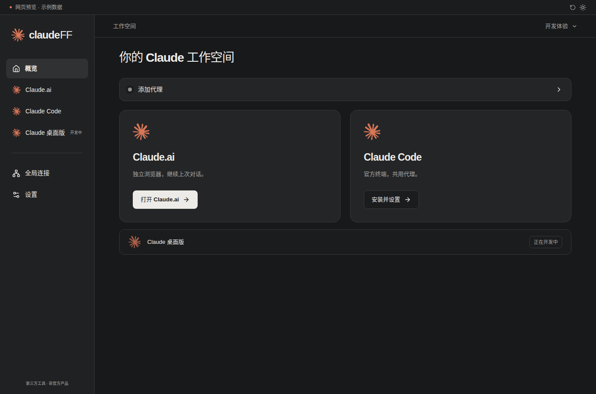
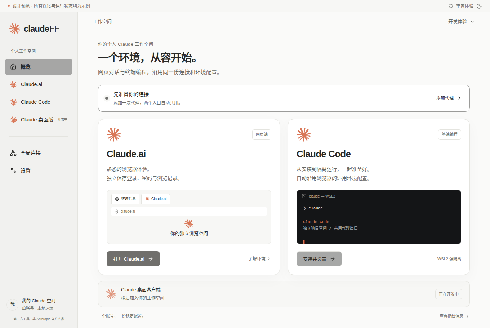
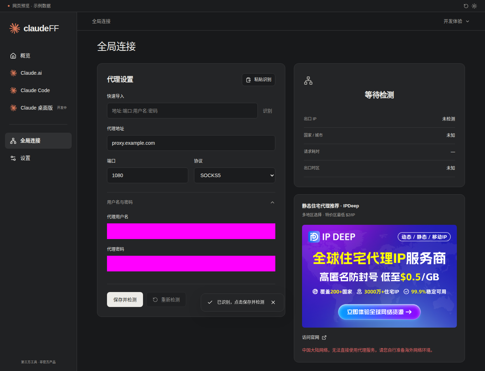

# 前端测试与优化记录

> 2026-10-12 更新：用户报告 V3 代理检测异常与秒退出，当前按完整产品基座重新评估；Donut 首选、CloakBrowser Manager 备选，尚未完成候选实测、迁移或发布新包。下文 V3 方案/测试为已有实现与历史证据，最新要求见 [基座选型评估](指纹浏览器基座选型评估.md)。

2026-10-11 · V3。按用户“精简、降噪、克制、干净”要求，去掉装饰浏览器/终端、重复说明、旧沙箱步骤和指纹差异弹窗。首页只保留两个入口、连接状态和桌面版占位；参数在浏览器指纹弹窗。

[最终前端云测](https://github.com/yingziseo/claudeFF/actions/runs/38069511848)：10 项通过，1 项真实后台测试在预览跳过；真实后台由 [独立服务工作流](https://github.com/yingziseo/claudeFF/actions/runs/38069511784) 运行并通过。

验证覆盖官方素材/三入口，四段式与 URL 自动填充、密码遮蔽、IPDeep 图片/推荐链接/固定红字，Code 独立使用、内核随包直接启动与缺失恢复，开发登录无认证请求，主题持久化、375px 无溢出、800px 主按钮可见、键盘/减少动画、初始化恢复和管理面板演示。

[Windows 实际窗口测试](https://github.com/yingziseo/claudeFF/actions/runs/38069511799) 使用原生 Wails/WebView2 与 Go 绑定，真实系统剪贴板/用户授权代理/完整内核/重启配置通过，不使用模拟 window.go。截图已脱敏。[Mac 双架构](https://github.com/yingziseo/claudeFF/actions/runs/38069511847) 的真实 React 管理界面通过事件桥报告就绪，截图确认加载；Intel 浏览器入口明确禁用。

以上为设计预览示例；实际窗口及未验证官方账号流程见 [进度报告](开发进度与验证报告.md)。没有把示例交互或进程存活当成全部业务验收。
