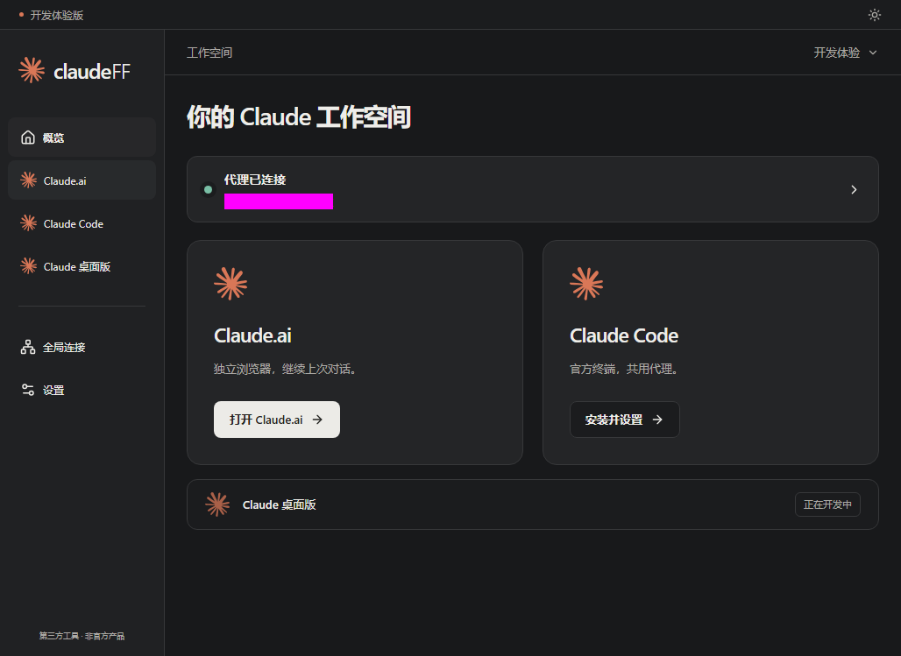
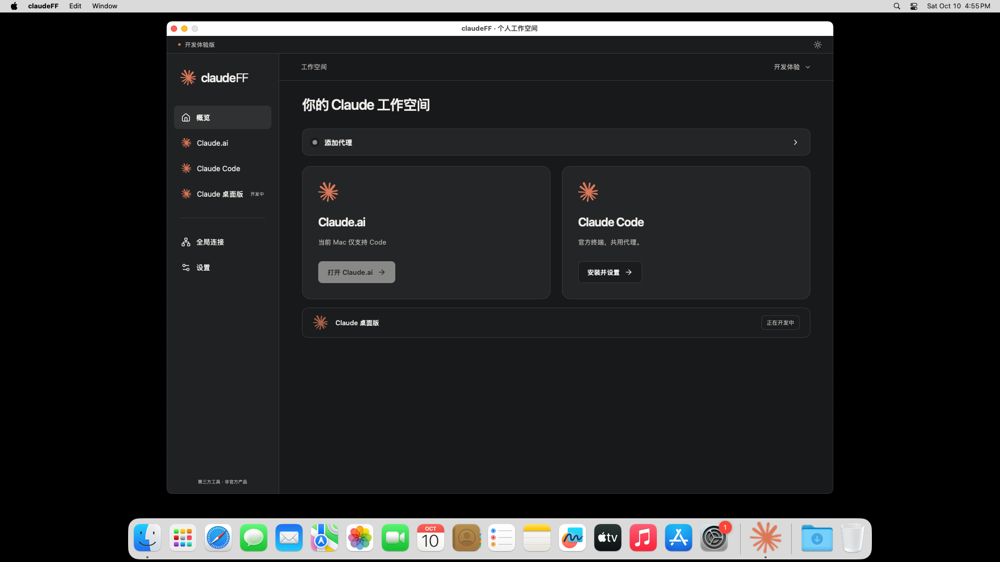

# 开发进度与验证报告

2026-10-11 · V3 开发体验版 **v0.3.0-dev.1 已发布**。产物源提交 `13082c5d7151e087f4ecddc22a6de50a1b34771f`。本次报告替代旧版按需内核下载/WSL 方案的验收结论；工作日志保留历史。

## 已实现并验证

| 项目 | 实际证据与范围 |
| --- | --- |
| 真实 Windows 管理界面 | 完整 EXE + 固定 WebView2 实际窗口，Playwright 连接原生实例，不替换 window.go；系统剪贴板自动识别、保存检测、启动浏览器、应用重启全部通过 |
| 用户授权真实代理 | HTTP 方式实际客户端检测出口匹配、SG/Singapore、Asia/Singapore、1050ms 请求耗时；真实随包浏览器出口一致。另有独立 HTTP/SOCKS5 网络诊断成功，不把诊断冒充客户端全部协议实测 |
| 代理导入与恢复 | 四段式、认证 URL、转义/IPv6/含冒号密码，拒绝误存认证串；407/超时/协议分类、备用站、地理信息匹配；旧误存主机自动修复与无法识别时重新填写，保留 profile；模块/前端云测通过 |
| 完整内置资源 | Windows ZIP 含完整 fingerprint-chromium 148 和 WebView2 155，固定摘要与微软签名验证，用户不下载内核；没有旧 WSL/Linux/helper 资源 |
| 浏览器恢复 | Windows 与 Apple Silicon 实际内核：认证测试代理、真实出口、语言/时区、同种子 Canvas、localStorage 与具体对话 URL 重启恢复通过；恢复不覆盖对话、不重复创建官网标签 |
| 官方原生 Code | Windows x64、Mac ARM/Intel 真实安装并运行官方 `2.1.287 (Claude Code)`；认证测试代理、ConPTY/PTY 输入/输出/尺寸、本机项目、停止后保留安装通过。没有沙箱、指纹/时区同步或先浏览器门槛 |
| 秘密存储 | Windows DPAPI 与 macOS Keychain 往返、随机密文/篡改拒绝相关测试通过；Windows 实际窗口配置重启保留且公开快照无密码 |
| Mac 管理界面 | 两架构真实 Wails/WKWebView 应用编译/启动，React 原生页面加载后通过事件桥向 Go 报告就绪，云端截图已检查；非仅进程存活 |
| 前端精简 | 10 项交互通过，1 项真实后台用例在公开预览跳过并由单独服务工作流运行；三入口、导入/商家/红字、Code 独立使用、内核缺失、主题、375px/800px、键盘及开发登录通过 |
| 后期授权代码 | 模块与独立真实服务/管理面板联动通过；生产未部署、最终商业规则未确认，开发 ZIP 保留登录跳过 |

原生 Code 复核的是传给该进程的转发入口，取消强隔离后不强制限制其所有子进程网络。代理秘密只临时用于加密云测，已删除 `CLAUDEFF_TEST_PROXY`；未写入仓库、日志、截图或发布包。后续无秘密的 CI 使用受控认证测试代理，如实标记，不假称用户住宅代理。

## 最终云端工作流

以下五项均针对同一产物源提交，全部成功；全部依赖、编译、测试和截图在 GitHub Actions。

| 工作流 | 结果 |
| --- | --- |
| [Windows portable client](https://github.com/yingziseo/claudeFF/actions/runs/38069511799) | 真实内核/Code/原生窗口/用户代理、完整 ZIP |
| [macOS native client](https://github.com/yingziseo/claudeFF/actions/runs/38069511847) | ARM + Intel 原生 Code、Keychain、管理渲染；ARM 内核恢复；双包 |
| [Core validation](https://github.com/yingziseo/claudeFF/actions/runs/38069511803) | 模块 race、代理与已有数据恢复回归 |
| [Frontend preview](https://github.com/yingziseo/claudeFF/actions/runs/38069511848) | 前端构建/交互/截图与公开部署 |
| [License service and panel](https://github.com/yingziseo/claudeFF/actions/runs/38069511784) | 真实服务/用户面板联动及服务构建 |
| [Publish verified portable packages](https://github.com/yingziseo/claudeFF/actions/runs/38069900156) | 核对五项同源成功、ZIP 摘要、Windows 包必备资源和逐文件摘要，再发布新 tag |

## 下载与包校验

[Release 页面](https://github.com/yingziseo/claudeFF/releases/tag/v0.3.0-dev.1) · [完整 SHA256 校验文件](https://github.com/yingziseo/claudeFF/releases/download/v0.3.0-dev.1/SHA256SUMS.txt) · [Windows 原生验证结果](https://github.com/yingziseo/claudeFF/releases/download/v0.3.0-dev.1/windows-native-verification.json) · [运行时来源](https://github.com/yingziseo/claudeFF/releases/download/v0.3.0-dev.1/RUNTIMES.json)

| 下载 | 大小 | 功能 |
| --- | --- | --- |
| [Windows x64 ZIP](https://github.com/yingziseo/claudeFF/releases/download/v0.3.0-dev.1/claudeFF-windows-x64.zip) | 514,867,735 bytes，约 491 MiB | 完整指纹浏览器 + 原生 Code；内置 WebView2 |
| [Mac Apple Silicon ZIP](https://github.com/yingziseo/claudeFF/releases/download/v0.3.0-dev.1/claudeFF-macos-apple-silicon.zip) | 162,589,694 bytes | 完整 ARM 指纹浏览器 + 原生 Code |
| [Mac Intel ZIP](https://github.com/yingziseo/claudeFF/releases/download/v0.3.0-dev.1/claudeFF-macos-intel.zip) | 7,916,554 bytes | 原生 Code；上游仅有 ARM Mac 内核，浏览器入口明确禁用 |

摘要：Windows `d6db6cb639368b2cf2bd738cde1d19caa7b0aca71ed8edb9e385cc0dc1d6342b`；Mac ARM `56399e9e5d909dd4afe721892124062d50dc38f50373a923447f40747a7b9ccc`；Mac Intel `5461b6b9c26ec588c169778c36bc72e1de2c82bc68e632c953473ad8e7021d4f`。

Windows 原生截图（出口信息已遮蔽）：

Mac Intel 原生截图（如实显示当前仅支持 Code）：

[网页预览](https://yingziseo.github.io/claudeFF/) 为示例数据；其截图不能替代原生验证。

## 尚未验收与后续

- 未用真实 Claude 账号完成登录、密码自动填充、OAuth 或模型请求；默认官网标签能打开不等于账号登录通过。直接 HTTPS 诊断曾返回 403，实际账号与挑战页面需要用户体验，不能宣称已完成。
- 原生 Code 官方登录若打开系统默认浏览器，该浏览器不自动使用本工具代理。可把登录链接复制到已启动的受管浏览器；Intel Mac 需使用已有可访问网络的浏览器。
- 全部扩展/字体、WebRTC/DNS/IPv6、高 DPI、各系统版本、长时间运行、异常掉电与升级恢复等未完整专项验收。Windows 云端运行器结果不等同用户 Win11 每种配置已测试；Mac 实际云测为 macOS 15。
- 开发产物未完成正式发行签名/公证，商业服务未部署；永久卡密策略、换机/恢复与运维仍最后收敛。Claude 桌面版按要求仅预留。

用户按运行说明解压新版实际体验后，可根据具体复现继续修正。旧 v0.2.0-dev.1 为历史产物，不再用它测试新版功能。
